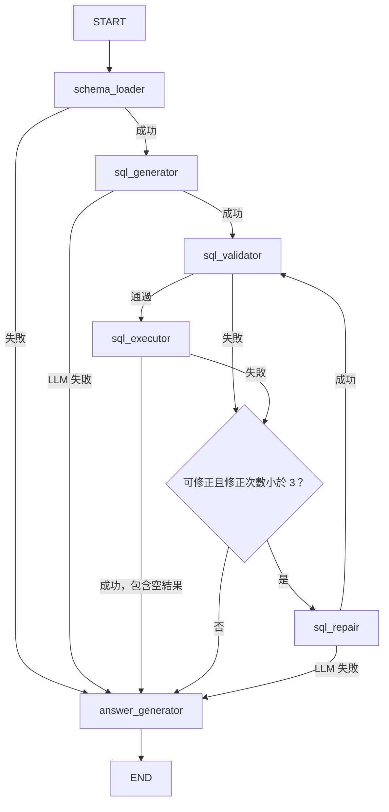

# Mini Text-to-SQL Agent — 中文智慧資料庫查詢助手

教學與作品展示用 MVP：將中文問題轉成 PostgreSQL 查詢，驗證後執行；SQL 出錯時最多修正三次，再以 Python 格式化繁體中文回答。重點是閱讀 LangGraph 的固定流程、State 與 Conditional Edges，適合在 1～2 天內審閱與測試。

## 技術架構

Python 3.11+、LangGraph、LangChain／`langchain-ollama`、PostgreSQL、SQLAlchemy／psycopg、SQLGlot、Gradio、python-dotenv 與 pytest。僅透過 `ChatOllama` 呼叫單一設定的 Ollama 模型，沒有模型路由或 Fallback；沒有 Agent 工具執行、Web Search、對話記憶或自動建表。

執行路徑：Gradio → LangGraph → SQL AST 驗證 → SQLAlchemy 唯讀交易 → Python 結果格式化。只有生成與修正 SQL 會呼叫 LLM，查詢結果不送去摘要。

## LangGraph 工作流程



`retry_count` 初始為 0，每次進入 `sql_repair` 增加 1。初次生成加上三次修正，最多四版 SQL；第三次修正仍有機會成功。連線、權限、初始化及 LLM 呼叫失敗直接結束，SQL 語法、欄位與逾時錯誤才進入修正。遞迴上限 32 是額外保護，業務上的停止條件仍是三次修正。

`AgentState` 包含 `question`、`schema`、`sql_query`、`query_result`、`error_message`、`error_kind`、`retry_count`、`final_answer`、`status`。每次問題建立新 State，不設定 Checkpointer。節點回傳局部更新，不直接修改 State。

Schema 在啟動時以唯讀交易讀取、檢查並快取，再交由 `schema_loader` 注入各次 State。啟動失敗會在 UI 顯示原因並停用送出；修正設定後重新啟動。Schema 變更也需要重新啟動。

## 專案結構

```text
text2sql/
├── app.py                 # 啟動、Gradio UI 與流程呼叫
├── graph.py               # TypedDict State、Nodes 與 Conditional Edges
├── nodes.py               # 六個 Node、提示詞、AST 驗證與回答
├── database.py            # Schema、帳號檢查、唯讀交易與 SQL 執行
├── config.py              # 環境設定與單一 ChatOllama 初始化
├── requirements.txt       # 已測試的直接相依版本
├── .env.example
├── .gitignore
├── README.md
└── tests/
    └── test_workflow.py
```

## 安裝與環境變數

以下 PowerShell 指令從專案目錄執行，不需要啟用虛擬環境：

```powershell
cd text2sql
python -m venv .venv
.\.venv\Scripts\python.exe -m pip install -r requirements.txt
Copy-Item .env.example .env
```

macOS／Linux 使用 `python3 -m venv .venv`、`.venv/bin/python -m pip install -r requirements.txt` 與 `cp .env.example .env`。

編輯 `.env`：

| 變數 | 說明 |
|---|---|
| `LLM_MODEL` | 必填；雲端 API 的模型名稱，例如 `gpt-oss:120b` 或 `nemotron-3-super`，以 `https://ollama.com/api/tags` 回傳為準 |
| `OLLAMA_BASE_URL` | 預設 `https://ollama.com`；直接連線 Ollama Cloud，不加 `/api` 或 `/v1` |
| `OLLAMA_API_KEY` | 直接連線 Ollama Cloud 時必填；在 [Ollama API Keys](https://ollama.com/settings/keys) 建立 |
| `LLM_TIMEOUT_SECONDS` | 預設 120；允許 1～600 秒，作為 Ollama HTTP 連線／讀取等操作的逾時 |
| `DATABASE_URL` | 必填；`postgresql+psycopg://帳號:密碼@主機:5432/資料庫` |
| `ALLOWED_TABLES` | 必填；範本已設定三張 AQI 資料表，完整設定見下方；多表以逗號分隔 |
| `STATEMENT_TIMEOUT_MS` | 預設 5000；允許 1～60000 毫秒 |
| `MAX_RESULT_ROWS` | 預設 100；允許 1～1000 筆 |

資料表設定只接受小寫的 `schema.table`，不接受系統 Schema 或需要引號的名稱。密碼包含 `@`、`:`、`/` 等字元時須 URL encode。現有環境變數優先於 `.env`；不要提交 `.env` 或輸出真實連線 URL。

### Ollama Cloud 直接連線

本專案預設直接透過 HTTPS 呼叫 Ollama Cloud，使用 `OLLAMA_API_KEY` 作為 Bearer 驗證，不需要安裝或啟動本機 Ollama，也不需要執行 `ollama signin` 或設定 `OPENAI_API_KEY`。先在 [Ollama API Keys](https://ollama.com/settings/keys) 建立金鑰，再編輯 `.env`：

```dotenv
LLM_MODEL=gpt-oss:120b
OLLAMA_BASE_URL=https://ollama.com
OLLAMA_API_KEY=填入你的_Ollama_API_Key
LLM_TIMEOUT_SECONDS=120
```

切換 Nemotron 只需將模型那行改為下列完整標籤，再重新啟動應用：

```dotenv
LLM_MODEL=nemotron-3-super
```

直接連線時請使用雲端 API 回傳的模型名稱；本機 CLI 的 `gpt-oss:120b-cloud` 與 `nemotron-3-super:cloud` 分別改為 `gpt-oss:120b` 與 `nemotron-3-super`。可用模型與帳號額度以 Ollama 官方服務為準。API Key 留在 `.env` 或環境變數中，不要寫入程式或提交到 Git。

可先列出雲端 API 可用模型，此指令不需要 API Key：

```powershell
Invoke-RestMethod https://ollama.com/api/tags | Select-Object -ExpandProperty models | Select-Object name
```

填好 `.env` 後，可在 `text2sql` 目錄用 Python 執行以下最小連線測試；只傳送固定提示詞，會使用帳號額度：

```python
from config import load_settings, create_llm

llm = create_llm(load_settings())
print(llm.invoke("只回答 OK").content)
```

若仍需本機模型，可將 `OLLAMA_BASE_URL` 改為 `http://localhost:11434`、`LLM_MODEL` 改為已下載的模型標籤，並清空 `OLLAMA_API_KEY`；此時須自行啟動本機 Ollama。雲端連線缺少 Key 時，應用會在初始化時明確提示。

應用只讀取模型最終 `content` 作為 SQL，不把 Ollama 獨立的 `thinking` 欄位當成 SQL；模型若輸出 Markdown 或其他非 SQL 內容，仍須經原本的驗證與修正流程。`LLM_TIMEOUT_SECONDS` 是 HTTP 操作逾時，不是整個 Graph 的總時間上限。

目前 `.env.example` 的查詢白名單如下，假設資料表位於 `public` Schema：

```dotenv
ALLOWED_TABLES=public.air_quality_hourly,public.air_quality_predictions,public.air_quality_predictions_8h
```

`langchain_pg_collection` 與 `langchain_pg_embedding` 先不加入白名單，也不在下方授予 SELECT。此 MVP 查詢 AQI 歷史與預測資料，不需要讀取這兩張 pgvector 相關表。三張 AQI 表的實際欄位與型別仍由啟動時讀取，不假設預測欄位或 JOIN 關係。

直接相依版本已固定，間接相依仍由 pip resolver 決定。實際驗證環境為 Windows、Python 3.12.7；Python 3.11 尚未執行驗證。

## PostgreSQL 權限與安全設定

**使用已有資料表的獨立示範資料庫。應用不建表、不新增角色，也不修改權限。** 下列 SQL 由管理員手動執行；資料庫、帳號及資料表名稱須換成實際值。

這個範例會撤銷示範資料庫中的 `PUBLIC` 權限，可能影響其他帳號，故只適用於專用示範環境。

```sql
-- 管理員連入既有的 air_quality_demo 資料庫後執行。
CREATE ROLE text2sql_reader LOGIN PASSWORD '請換成你的密碼'
    NOSUPERUSER NOCREATEDB NOCREATEROLE NOINHERIT NOREPLICATION NOBYPASSRLS;
-- 在 psql 用 \password text2sql_reader 設定密碼，避免把密碼寫入版本控制。

REVOKE ALL ON DATABASE postgres FROM PUBLIC;
GRANT CONNECT ON DATABASE postgres TO text2sql_reader;
REVOKE ALL ON SCHEMA public FROM PUBLIC;
GRANT USAGE ON SCHEMA public TO text2sql_reader;

-- 關閉 PUBLIC 在此 Schema 既有物件上的授權。
REVOKE ALL ON ALL TABLES IN SCHEMA public FROM PUBLIC;
REVOKE ALL ON ALL SEQUENCES IN SCHEMA public FROM PUBLIC;
REVOKE EXECUTE ON ALL ROUTINES IN SCHEMA public FROM PUBLIC;

GRANT SELECT ON TABLE
    public.air_quality_hourly,
    public.air_quality_predictions,
    public.air_quality_predictions_8h
TO text2sql_reader;
ALTER ROLE text2sql_reader SET default_transaction_read_only = on;
ALTER ROLE text2sql_reader SET statement_timeout = '5s';
ALTER ROLE text2sql_reader SET search_path = pg_catalog;
```

若 `text2sql_reader` 已建立，且原本的唯讀權限設定已完成，只需執行上述三張表的 `GRANT SELECT` 區塊，不必重跑 `CREATE ROLE`。更改 `.env` 後重新啟動應用，以重新載入三張表的 Schema。

若 `public` 是專供此應用查詢、且不包含敏感資料表的 Schema，也可以把上方逐表列出的 `GRANT SELECT ON TABLE ...` 改成以下語法，一次授權目前已存在的所有資料表：

```sql
GRANT SELECT ON ALL TABLES IN SCHEMA public
TO text2sql_reader;
```

`GRANT ... ON ALL TABLES IN SCHEMA` 只作用於執行當下已存在的資料表，不會自動套用到未來新建的資料表。若要讓未來由指定物件建立者建立的新表自動取得 SELECT，可另外設定：

```sql
-- data_owner 必須換成實際建立資料表的角色；每個建立者各設定一次。
ALTER DEFAULT PRIVILEGES FOR ROLE data_owner IN SCHEMA public
    GRANT SELECT ON TABLES TO text2sql_reader;
```

資料庫授權不會擴大應用程式的查詢白名單；需要查詢的新表仍須加入 `.env` 的 `ALLOWED_TABLES`，並重新啟動應用。若 Schema 內可能出現不應暴露給 Text-to-SQL 的資料表，應保留逐表授權，不要使用上述整個 Schema 的授權方式。

對每個白名單 Schema／資料表重複必要的 USAGE／SELECT 授權。唯讀帳號不可擁有資料庫、Schema 或資料表，不授予其他角色成員資格，也不可授予 `pg_read_server_files`、`pg_write_server_files`、`pg_execute_server_program` 等能力。若使用已存在的帳號，還需要檢查並移除既有直接授權、角色成員資格與其他 Schema 的權限；上述建立新角色的範例不會清理舊帳號。

管理員可針對實際物件建立者設定未來物件的預設權限：

```sql
-- 必須指定真正建立物件的角色；每個建立者各做一次。
ALTER DEFAULT PRIVILEGES FOR ROLE data_owner
    REVOKE EXECUTE ON FUNCTIONS FROM PUBLIC;
ALTER DEFAULT PRIVILEGES FOR ROLE data_owner IN SCHEMA public
    REVOKE ALL ON TABLES FROM PUBLIC;
ALTER DEFAULT PRIVILEGES FOR ROLE data_owner IN SCHEMA public
    REVOKE ALL ON SEQUENCES FROM PUBLIC;
```

不自動授予未來資料表 SELECT。新增白名單表時由管理員明確授權，再重新啟動應用。`data_owner` 是範例名稱，需替換；應用登入者不能是此物件建立者。

啟動檢查會拒絕具管理旗標、資料庫 CREATE／TEMP、白名單表寫入權限或相關 Schema CREATE 權限的帳號，也檢查白名單表可 SELECT。**這不是完整 PostgreSQL 權限稽核**；所有角色、其他 Schema、自訂函式與擴充套件仍由管理員檢查。

若顯示「帳號權限過大」，可用唯讀帳號檢查它的有效資料庫權限：

```sql
SELECT
    has_database_privilege(current_database(), 'CREATE') AS can_create,
    has_database_privilege(current_database(), 'TEMP') AS can_create_temp;
```

本機目前確認 `text2sql_reader` 的 `can_create_temp` 為 true，來源是 `PUBLIC` 的 TEMPORARY 授權，所以目前 Schema 啟動檢查仍會失敗。只對 `text2sql_reader` 執行 REVOKE 不會移除它從 `PUBLIC` 取得的權限。專用示範資料庫可由管理員撤銷 `PUBLIC` 的 TEMPORARY，再明確授回給需要的其他角色；共用資料庫則先確認其他程式是否需要暫存表。這次 Ollama 切換沒有變更任何實際資料庫授權。

### 執行時防護

1. SQLGlot 以 PostgreSQL 方言解析完整輸出，只接受一個 SELECT 與有限的 AST 節點。
2. 遞迴檢查 CTE／子查詢；區分 CTE 別名與真正資料表來源，禁止白名單外資料表、寫入型 CTE、`SELECT INTO`、鎖定與管理指令。
3. 函式採白名單：常用聚合、`PERCENTILE_CONT`／`PERCENTILE_DISC`、`EXTRACT`／`DATE_TRUNC`、常用數字及文字函式。禁止任意函式、schema-qualified 函式、自訂型別與未支援語法。
4. 執行重新產生的 PostgreSQL SQL；移除註解、補上實體表 Schema、限制最外層結果筆數。不是先 LIMIT 來源資料，因此不改變 AVG／COUNT 等聚合的輸入範圍。
5. 每次資料庫操作都在明確唯讀交易中，設定 transaction-local statement timeout、最多 1 秒 lock timeout 及 `search_path = pg_catalog`。連線逾時為 5 秒。
6. 最多查詢及讀取 `MAX_RESULT_ROWS + 1` 筆，用多出的一筆判斷截斷，只顯示上限筆數。使用者較小的 LIMIT 會保留；超過上限則標示截斷。

SQL Parser **不是安全沙箱**，PostgreSQL 唯讀交易也無法阻止所有外部副作用。此 MVP 假設資料庫、內建函式與物件建立者可信任；不要接到含惡意自訂型別、運算子、政策、外部資料來源或不受控擴充套件的資料庫。不對不受信任公眾開放。

## 啟動方式

完成 `.env` 與唯讀權限設定後：

```powershell
.\.venv\Scripts\python.exe app.py
```

瀏覽 `http://127.0.0.1:7860`（若連接埠被占用，以終端顯示的 URL 為準）。介面包含中文問題、送出按鈕、中文回答、最新 SQL、執行結果與修正次數。只綁定本機，不啟用 Gradio 公開分享。

沒有資料時正常回報「查無符合條件的資料」。`COUNT(*)` 的零筆計數會顯示數值 0。日期、Decimal 與 NULL 由 Python 格式化，不推測單位或改寫數字。

## 測試方式

```powershell
.\.venv\Scripts\python.exe -m pytest -q
```

測試使用真正的 StateGraph 與 Validator，搭配 Mock LLM／Database，不需要 `.env`、真實 API Key、執行中的 Ollama、網路或 PostgreSQL。涵蓋成功、驗證／執行錯誤修正、三次停止、第三次修正成功、空結果、連線／權限錯誤、LLM 失敗、CTE／函式安全驗證、結果上限、Schema、設定與 Gradio callback。Ollama 原生回應另外以 Mock HTTP transport 驗證雲端網址、Bearer 驗證、逾時與本機無 Key 連線，確認最終 SQL 不包含獨立推理欄位；401 驗證失敗不執行 SQL，也不顯示 API Key。

Mock 測試只確認唯讀與逾時設定有送出，不能證明 PostgreSQL 真正執行效果；需在實際資料庫另外驗證角色、權限、逾時、驅動串流與查詢結果。

## SQL 自動修正範例與人工驗證

以假設具有 `aqi` 欄位的測試 Schema 為例：首次輸出引用 `missing_column` 的 SELECT → PostgreSQL 回報 SQLSTATE `42703` → 將原 SQL、錯誤與實際 Schema 傳給 LLM → 修正 SQL → 再次驗證 → 再次執行 → 中文回答。實際應用沒有預設 AQI 欄位或問題對應 SQL。

先執行可重現的離線修正測試：

```powershell
.\.venv\Scripts\python.exe -m pytest -v tests/test_workflow.py -k "syntax_error_repaired or database_sql_error_repaired or third_repair_can_succeed or stops_after_exactly_three_repairs"
```

要在真實資料庫人工驗證，可在專案目錄開啟 Python，貼上下列內容。只將首次輸出替換為必定錯誤的欄位，後續修正仍呼叫 `.env` 設定的真實 Ollama 模型；需先設定有效的 `OLLAMA_API_KEY` 並確認模型可用，會使用 Ollama 帳號額度。

```python
from unittest.mock import Mock
from langchain_core.messages import AIMessage
from config import load_settings, create_llm
from database import create_db_engine, load_schema, execute_sql
from graph import build_graph, initial_state, GRAPH_RECURSION_LIMIT

settings = load_settings()
engine = create_db_engine(settings)
schema = load_schema(engine, settings)
real_llm = create_llm(settings)
llm = Mock()
first = True

def controlled_invoke(messages):
    global first
    if first:
        first = False
        table = settings.allowed_tables[0]
        return AIMessage(content=f'SELECT "__intentional_missing_column__" FROM {table}')
    return real_llm.invoke(messages)

llm.invoke.side_effect = controlled_invoke
workflow = build_graph(llm, schema, settings.allowed_tables,
    lambda sql: execute_sql(engine, sql, settings), settings.max_result_rows)
for update in workflow.stream(initial_state("請顯示這張資料表的前五筆資料"),
        config={"recursion_limit": GRAPH_RECURSION_LIMIT}, stream_mode="updates"):
    print(update)
engine.dispose()
```

確認 `sql_executor` 首次出現欄位錯誤、`sql_repair` 的 `retry_count` 增加，以及修正 SQL 經過 `sql_validator` 才能再次執行。若修正仍失敗，應在三次後停止；不得預設真實 LLM 一定一次成功。示範欄位名稱必須確實不存在；stream 會印出 Schema 與資料，只在可信任的本機終端使用。

以下人工問題須依真實欄位與資料年份調整：

1. 哪一個月 AQI 平均值最高？
2. 2025 年 AQI 超過 100 的資料有幾筆？
3. 2025 年每個月的 AQI 中位數是多少？
4. 哪一天的 AQI 最大？
5. 2025 年每個月各有多少筆資料？
6. 查詢一段確定沒有資料的日期，確認空結果處理。

日期範圍與時區以 PostgreSQL 欄位型別及資料庫設定為準。問題若沒有指定年份，第一版由 LLM 依問題解讀；使用者應指定完整日期範圍以降低歧義。

## 已知限制與驗證範圍

- 只支援受控 PostgreSQL 的一般表／分割表，不支援 View、外部表、資料表函式、遞迴 CTE、UNION、Window 或任意函式。多白名單表可 JOIN。
- Validator 檢查安全結構與來源，不建立完整 SQL 型別／欄位解析器。欄位不存在、聚合與型別錯誤由 PostgreSQL 回報後修正。
- SQL 執行成功不代表問題解讀正確；仍需審閱日期、分組、NULL 與 JOIN 的語意。無法由 Schema 自動推知業務單位。
- 筆數上限不限制每格資料大小；聚合或 JOIN 仍可能昂貴，主要依 statement timeout 保護。三次修正也可能累積多次資料庫與 LLM 等待時間。
- 沒有多模型、RAG、登入、長期記憶、圖表或背景工作。Gradio 的間接套件包含其內部 Web 服務依賴，本專案不另建 API 服務。
- 先前版本曾透過本機 Ollama 呼叫雲端模型完成最小連線測試；這不代表目前的雲端 API Key 直連已完成實測。目前直連以離線 Mock HTTP 測試驗證，實際雲端連線仍需設定有效 Key 後確認。PostgreSQL 帳號先前可連線，但 Schema 啟動檢查因 `PUBLIC` 的 TEMPORARY 授權而失敗；完整三表查詢、唯讀交易實際阻擋效果與逾時效果仍需另外驗證。

## 官方參考

- [LangGraph Graph API](https://docs.langchain.com/oss/python/langgraph/graph-api)
- [LangChain ChatOllama](https://docs.langchain.com/oss/python/integrations/chat/ollama)
- [Ollama Cloud](https://docs.ollama.com/cloud)
- [Ollama API 驗證](https://docs.ollama.com/api/authentication)
- [Ollama GPT-OSS 模型標籤](https://ollama.com/library/gpt-oss)
- [Ollama Nemotron 3 Super 模型標籤](https://ollama.com/library/nemotron-3-super)
- [SQLGlot 文件](https://sqlglot.com/sqlglot.html)
- [PostgreSQL 唯讀交易](https://www.postgresql.org/docs/current/sql-set-transaction.html)
- [PostgreSQL 權限](https://www.postgresql.org/docs/current/ddl-priv.html)
- [PostgreSQL statement timeout](https://www.postgresql.org/docs/current/runtime-config-client.html)
